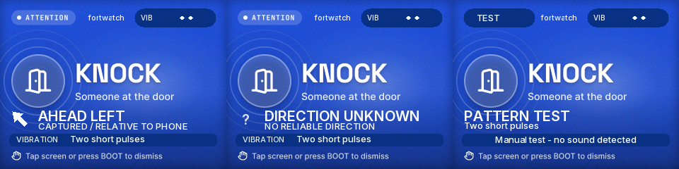

# Ritmos por sonido y dirección visible

**Revisión posterior instalada:** [identidad de sonidos](design/SOUND-IDENTITY.md).
Este documento conserva la verificación de la revisión anterior.

25/10/2026. Continúa el [diagnóstico previo](DIRECTION-DESIGN-UPDATE.md).

## Qué cambió

- Diez ritmos distintos por tipo de sonido, con la misma tabla temporal en iPhone
  y firmware. KNOCK conserva dos pulsos cortos; ALARM, tres largos. La lista
  completa y uso están en [ios/README](../ios/README.md#ritmos-por-sonido).
- **… → Sound & vibration guide** muestra cada ritmo y permite probarlo con la
  pulsera conectada y escucha detenida. No requiere calibración.
- `P,<EVENT>` es una prueba manual marcada TEST / PATTERN TEST, sin dirección,
  confianza, historial, contador de detecciones ni subida al dashboard.
- Flecha rellena y lado grande en ambas pantallas. El iPhone destaca el lado en
  una franja lima; conserva foto, fuentes y paneles de la marca. La pulsera
  conserva sus tarjetas originales e indica el ritmo real en VIB.
- Sin medición válida no se dibuja una flecha. La dirección es relativa al iPhone
  fijo y calibrado, no a la muñeca. Un solo motor identifica tipos mediante ritmos;
  no produce vibración física a izquierda/derecha.

## Verificación de esta revisión

| Prueba | Resultado |
|---|---|
| iOS simulador | PASS: 37 tests, 0 fallos |
| App iPhone firmada | PASS: build normal y build del diagnóstico optativo |
| Contrato de ritmos | PASS: tablas Swift/C++ compiladas, diez patrones idénticos y únicos |
| Host C++ con ASan/UBSan | PASS: parser de alertas y patrones acotados, distintos, conocidos; rechazo de P inválido |
| Helpers reales del firmware en host | PASS: 3,661 renders; bounds, regiones originales, tiempos/interrupción/wrap del motor y aislamiento de P |
| Firmware con dashboard conservado | PASS: RAM 84,100 B; flash 3,621,485 B |
| Pulsera instalada | PASS: 3,621,856 B escritos solo en app0; hash verificado; reinicio solicitado por esptool |
| iPhone instalado | PENDING: Xcode muestra el dispositivo no disponible; se pidió reconectarlo |
| Diferenciación táctil por una persona | PENDING: los patrones difieren, todavía falta probar que resulten distinguibles |
| Calibración y dirección física | FAIL / NOT VERIFIED: los últimos intentos siguen rechazados; esta revisión no cambia el estimador |
| Dashboard en red real | Sin nueva verificación; configuración privada conservada |

Evidencia local en `/tmp/fortwatch-design-update/`: `type-haptics-tests.xcresult`,
`type-haptics-tests.log`, `type-haptics-device-build.log`,
`type-haptics-firmware-build.log`, `type-haptics-flash.log`,
`type-haptics-render.log` y `haptics-*-preview.png`.

El diagnóstico optativo `FORTWATCH_BAND_PROBE` compila, pero no se ejecutó por
falta de conexión con el teléfono. Compara métricas de cuatro bandas sin guardar
audio ni modificar el procesamiento de producción. Su eventual PASS solo
demostraría captura/informe, no ángulos correctos.

## Prueba siguiente

1. Reconectar/desbloquear el iPhone para instalar la app ya compilada.
2. Conectar desde FortWatch; abrir la guía y comparar KNOCK, ALARM y DOORBELL.
3. Validar fuente y posición conocidas antes de dar por resuelta la calibración.

