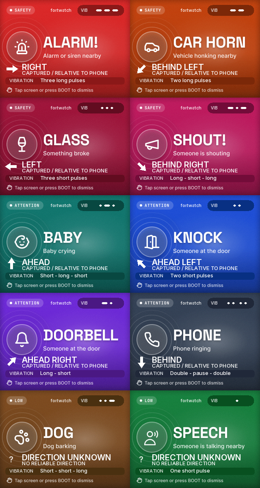
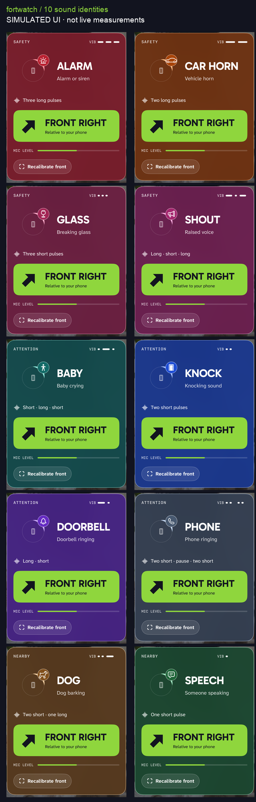

# FortWatch — identidad de los sonidos

25/10/2026. Aplicación nativa iPhone + pantalla de pulsera 320 × 240.

## Criterio

Herramienta de escucha accesible, con la foto y vidrio de la referencia FortWatch,
tipografía blanca, punto lima y acciones lima. Variación 4/10, movimiento 1/10,
densidad 6/10. El color identifica categorías junto al símbolo y el nombre;
ninguna información depende solo del color.

`SoundIdentity.swift` centraliza los diez tipos. Alerta, biblioteca e historial
usan ese catálogo; no hay tablas visuales divergentes en cada vista. La pulsera
conserva sus diez ilustraciones originales. La paleta mantiene la asociación
existente: alarma roja, bocina naranja, vidrio carmesí, grito magenta, bebé teal,
golpe azul, timbre violeta, teléfono gris azulado, perro marrón y voz verde.

- Marca: lima `#8FD63D`, tinta `#12141F`, Gabarito + Atkinson Hyperlegible Next.
- Alertas: superficie del color de la categoría sobre base oscura, borde de señal,
  símbolo reconocible, nombre grande, significado y descripción del ritmo.
- Ubicación: flecha rellena y texto en franja lima solo con una dirección vigente.
- Historia: `RECENT SOUND`, tiempo relativo, envío y `Past detection · no live location`.
  No copia el ángulo de un sonido posterior. Se conserva al detener/recalibrar y
  se limpia al empezar una nueva escucha; no se escribe en disco.
- Biblioteca: acceso visible en inicio, diez tarjetas con ejemplos, ritmo y Test.
- Inicio: `Start listening` reconoce sin calibrar. `Calibrate front` es una acción
  específica para ubicación; durante su intento se pausa el reconocimiento.
- Pulsera: marca discreta, título/ícono originales, dirección capturada legible,
  y patrón explicado en texto en lugar de la barra diminuta de confianza.
- Prueba manual: TEST/PATTERN TEST; nunca se presenta como detección real.

## Evidencia

| Requisito | Resultado |
|---|---|
| Diez categorías con identidad y ritmo propios | PASS: catálogo/selector/hápticos coinciden; símbolos y textos distintos |
| Los 22 alias existen y se asignan a su categoría | PASS: clasificador Apple instalado y pruebas de selección aisladas |
| Contraste de paleta | PASS: blanco sobre los diez colores ≥6:1; señal sobre tinta ≥8.7:1 |
| Biblioteca real | PASS: abre desde inicio; árbol accesible contiene las diez categorías y Test deshabilitado sin conexión |
| Datos recientes sin dirección prestada | PASS: 4 pruebas específicas de presentación |
| Suite iOS | PASS: 47 tests, cero fallos |
| Pantallas normales de los diez sonidos | PASS: renders nativos aislados, etiquetados como simulación, inspeccionados |
| Letra de accesibilidad máxima | PASS del rótulo de dirección aislado y reflujo superior; recorrido completo con scroll/VoiceOver pendiente |
| Estados inciertos y recientes | PASS: sin flecha en unknown, recent-live-angle y fallo de calibración con detección |
| Firmware | PASS: build; 3,661 renders de helpers reales con ASan/UBSan; patrón e historial preservados |
| Instalación pulsera | PASS: app0 escrita, hash verificado; configuración privada y NVS conservadas |
| Instalación iPhone | PASS: instalada y abierta tras desbloqueo; corrección final de texto reinstalada |
| Prueba acústica preliminar | Esperado en 13/14 archivos públicos; muestra pequeña de seis categorías, sin negativos |
| Reconocimiento físico / diferenciación táctil | PENDING: requiere prueba en el contexto del usuario |
| Dirección física | Sigue sin validación; últimos intentos de calibración fallaron |

Las capturas de diseño usan valores sintéticos. No son pruebas de detección,
de precisión angular ni de vibración física. Los detalles del audio público y
los límites están en [la auditoría](../SOUND-RECOGNITION-AUDIT.md).

Evidencia de esta revisión: `/tmp/fortwatch-identity-update/identity-tests.xcresult`,
`identity-device-final-build.log`, `iphone-final-install.log`, `firmware-build-retry.log`,
`firmware-flash.log`, `firmware-render.log`, `screens/`.

## Uso

1. Abrir FortWatch y tocar **Connect**.
2. Abrir **Sound library** y comparar los patrones con **Test**, sin escuchar.
3. Volver y tocar **Start listening**. La calibración de ubicación es independiente.

La revisión de píxeles detectó texto secundario con contraste 3.91–4.17:1 en
zonas de las tarjetas neutras. Se cambió su capa blanca por tinta al 45%; las
mismas cuatro muestras quedaron entre 8.45 y 11.53:1. No es una auditoría de
cada píxel de la pantalla. La corrección compiló para simulador/iPhone y se
instaló (`contrast-iphone-install.log`). La captura actual de la biblioteca es
de la app real del simulador, sin detecciones ni conexión BLE.
