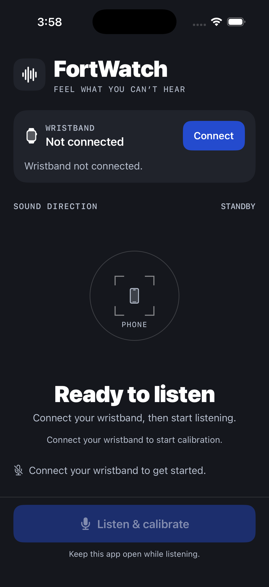

# FortWatch Listener — interfaz iPhone

Herramienta de escucha para usar el iPhone junto a la pulsera: fondo carbón,
tipografía blanca fuerte y colores por categoría, siguiendo las pantallas
originales. Implementación nativa en SwiftUI, iOS 26. Toda la interfaz está en inglés.

Variación visual 5/10, movimiento 1/10, densidad 5/10. Sin animación decorativa.

- Base `#15171D`, superficie `#20232B`, texto secundario `#B8C0CF`.
- Azul `#244BCE` para conectar/iniciar; rojo para detener. Colores propios de las
  diez categorías en las alertas. Conexión Bluetooth confirmada en verde.
- Dirección: arco parcial afilado y un ícono alrededor del retículo del teléfono.
  La anchura del arco es diseño; no representa una precisión angular medida.
- Una guía circular neutral queda visible sin una dirección válida. La pantalla
  distingue calibración pendiente, fallo de calibración y dirección incierta.
- Una categoría usa el ángulo de su misma ventana. Entre alertas puede aparecer
  una señal genérica del sonido dominante. Dirección incierta no muestra marcador.
- **Latest alert** mantiene el historial separado de la dirección reciente.
- **Listen & calibrate** inicia micrófono y calibración en una acción; el círculo
  aparece antes del nivel/estado. Inicio/parada visible abajo. Con tamaños de accesibilidad se integra al contenido
  desplazable. Texto con Dynamic Type, controles de al menos 44 pt y nombres VoiceOver.
- Conserva conexión, cancelación, desconexión, prueba de vibración, calibración,
  permisos y acceso a Settings. Audio procesado en el iPhone, sin grabarlo.

## Verificación, 25 de octubre de 2026

- Compilación en simulador y iPhone físico: PASS.
- 30 pruebas de audio, dirección, eventos y contrato BLE: PASS.
- Inspección visual de pantalla inicial normal y texto de accesibilidad máximo:
  contenido visible y reflujo; el tamaño máximo requiere desplazamiento.
- Árbol de accesibilidad contiene controles y estado. VoiceOver manual y
  desplazamiento completo con texto máximo no verificados.
- Instalación y apertura automática en iPhone físico: PASS.
- Usuario confirma conexión BLE, KNOCK con el diseño nuevo y dos pulsos de vibración.
- Captura FOA probada en el iPhone real: 50 actualizaciones válidas en la prueba optativa.
- Signo y precisión angular: pendientes de confirmar con sonidos desde cada lado.

Estado detallado: [actualización](../../DIRECTION-DESIGN-UPDATE.md).

