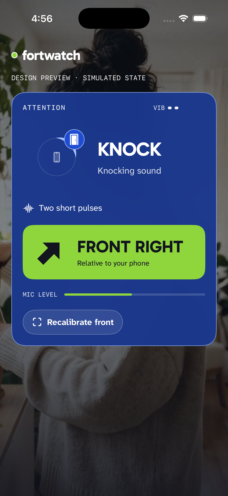
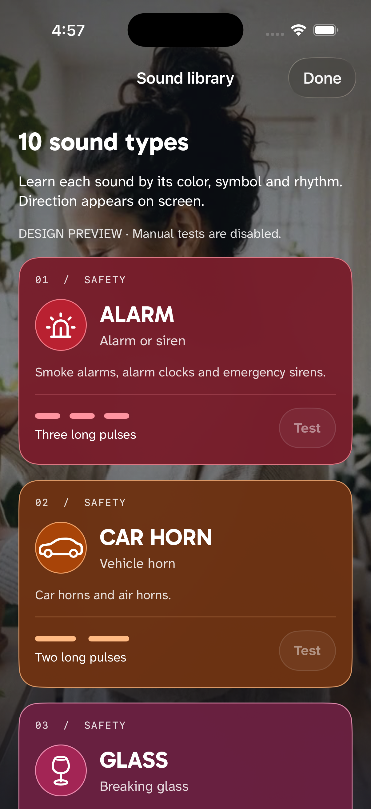

# FortWatch Listener — interfaz iPhone

**Estado actual:** el catálogo de 521 clases y su validación están en
[SOUND-CATALOG-521.md](../../SOUND-CATALOG-521.md). La instalación y las 47 pruebas
descritas en la primera sección corresponden a la revisión anterior de diez alertas.
La versión final de 521 clases todavía necesita instalarse junto con su firmware.

La referencia vigente es la landing FortWatch mostrada por el usuario el 25/10:
foto de fondo oscurecida, paneles translúcidos, marca `fortwatch` en minúsculas,
tipografía blanca y acciones lima. Se reutilizan la foto de `docs/landing/` y
sus colores; Gabarito y Atkinson Hyperlegible Next se incluyen con sus licencias OFL.
Toda la interfaz está en inglés y usa SwiftUI nativo, iOS 26.

Lectura de diseño: herramienta accesible de escucha, funcional y compacta, con el
estilo fotográfico de la marca. Variación 4/10, movimiento 1/10, densidad 6/10.

- Acento `#8FD63D`, texto de botón `#12141F`, borde glass blanco al 38%.
- Cabecera pequeña, conexión visible, un panel de sonido y acción inferior.
- Una franja lima con flecha rellena y lado grande destaca la dirección.
- El arco e ícono aparecen únicamente con una medición utilizable; una alerta
  usa el ángulo de su propia ventana. La anchura del arco no expresa precisión.
- Inicio, permisos, calibración, rechazo e incertidumbre tienen estados explícitos.
- Sound library aparece directamente en inicio y permite aprender y probar los diez ritmos.
- Un catálogo único aporta nombre, significado, símbolo y colores a alerta, biblioteca e historial.
- Recent sound conserva la última detección sin una flecha vencida.
- Start listening reconoce sin exigir calibración; Calibrate front se usa para ubicación.
- Test vibration, guía de ritmos, ayuda, Settings y Disconnect están en el menú **…**.
- Colores por categoría en el badge; historial separado de la dirección reciente.
- Dynamic Type, objetivos de 44 pt o más, nombres VoiceOver, reflujo vertical en
  accesibilidad y panel opaco con Reduce Transparency. Sin animación decorativa.

## Verificación

- Builds de simulador y de iPhone: PASS. App instalada en el teléfono; firmware
  actualizado y hash verificado. La app se abrió tras el desbloqueo del usuario;
  luego se reinstaló una corrección de texto. Esa última reapertura encontró el teléfono bloqueado.
- 47 pruebas de audio, calibración, eventos, catálogo, historial y protocolo: PASS.
- Contrato compilado iPhone/pulsera: los diez ritmos coinciden y son distintos.
- Pantalla inicial y fixtures de KNOCK/calibración fallida inspeccionados en simulador.
- El fixture de abajo está etiquetado **SIMULATED STATE** y no usa micrófono/BLE.
- VoiceOver manual, precisión angular y aprobación visual del usuario: pendientes.

Estado funcional y pruebas físicas: [identidad de sonidos](../SOUND-IDENTITY.md).

## 521-class catalog static renders

`yamnet-cat.png`, `yamnet-long-name.png` and `yamnet-recent.png` come from the
production SwiftUI card, rendered with ImageRenderer at 393×852 pt, 2× scale.
They are explicitly marked simulated states. ImageRenderer does not rasterize
UIKit-backed scroll/navigation wrappers and its material appearance is not a
physical display capture. The first attempted export contained only the backdrop;
that attempt was rejected and the final export renders the shared card content
directly. Cat and the longest-name card were visually inspected without clipping.
The actual Simulator library was subsequently opened through the normal home
screen. Searching `Piano` returned Piano and Electric piano; clearing search
restored 521 entries. The Nature filter returned 17 entries. Searching `zzzz`
showed the explicit no-results state, and dismissing search restored that family.
`yamnet-library-search.png` records the actual disconnected app, not a fixture.
Physical screen viewing and manual VoiceOver remain pending.

`yamnet-library-samples.png` renders three production library rows (Cat, Rain,
Livestock and farm animals) with disabled tests. `yamnet-library-largest-text.png`
renders the long row at accessibility5. Both are marked simulated states; they
check wrapping and vertical reflow without asserting scroll/navigation behavior.
